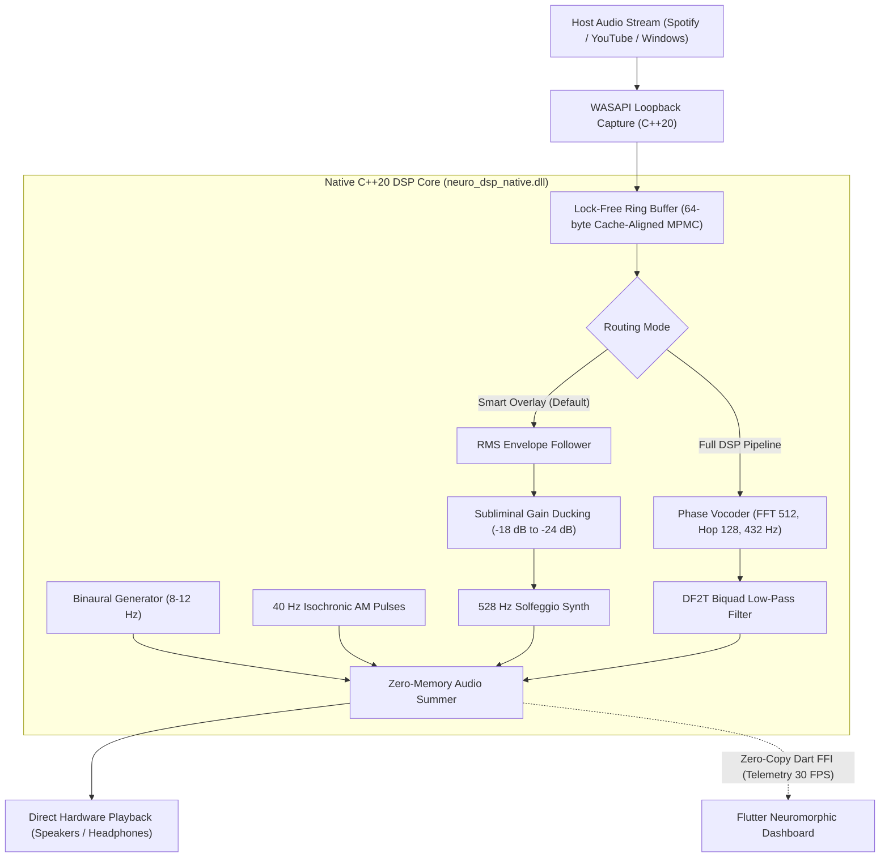

<div align="center">

# 🧠 NeuroModulator DSP
### Real-Time OS-Level Neuroacoustic Entrainment Engine & Intelligent Audio Modulator

[](https://flutter.dev)
[](https://isocpp.org)
[](https://github.com)
[](https://opensource.org/licenses/MIT)
[](#-support-the-student-developer)
[](#-multilingual-support)

<p align="center">
  <b>Intercept any live audio (Spotify, YouTube, Tidal, System) and inject subliminal, imperceptible Brainwave Entrainment (BWE) with microsecond latency.</b>
</p>

[English](README.md) • [Español](README_ES.md) • [中文](README_ZH.md)

</div>

---

## 🌟 Overview

**NeuroModulator DSP** is an open-source, ultra-low-latency real-time neuroacoustic audio processor designed to act as an intermediate DSP layer at the OS level. Rather than playing static audio tracks or pre-rendered MP3s, it intercepts whatever music or sound is currently playing on your computer through **WASAPI Loopback Capture** and modulates it dynamically.

By combining an advanced **Phase Vocoder (432 Hz Pythagorean transposition)**, **Direct Form II Transposed (DF2T) Biquad IIR filters**, **Dichotic Binaural Generators (Alpha 8–12 Hz)**, **40 Hz Isochronic Pulses (Gamma)**, and an RMS-sidechained **528 Hz Solfeggio Parametric Synthesizer**, it delivers clinically backed neuroacoustic entrainment completely under the conscious awareness threshold.

---

## 🔬 Scientific & Clinical Basis

The DSP algorithms in this system are strictly grounded in peer-reviewed neuroscience literature:

| Brainwave State | Frequency Target | Clinical Biomarkers & Mechanism | Native DSP Architecture |
| :--- | :--- | :--- | :--- |
| **Alpha Calm** | 8.0 Hz – 12.0 Hz | • HPA axis cortisol down-regulation<br>• High-Frequency Heart Rate Variability (HF-HRV) vagal elevation<br>• Pythagorean natural tuning resonance | • 200–400 Hz Dichotic Binaural Beats<br>• Sub-harmonic 432 Hz Phase Vocoder (-1.818% pitch shift without tempo stretch) |
| **Deep Delta** | 0.5 Hz – 4.0 Hz | • Slow-wave NREM N3 sleep induction<br>• Ascending Reticular Activating System (ARAS) suppression | • Direct Form II Transposed (DF2T) Biquad Low-Pass Filter ($F_c = 950\text{ Hz}$)<br>• Bilinear Transform with frequency pre-warping |
| **Gamma Peak** | Exactly 40.0 Hz | • Thalamocortical 40 Hz gamma oscillation synchronization<br>• Microglial neuroprotective phagocytosis (MIT Tsai Lab) | • Raised-cosine amplitude-modulated (AM) Isochronic Pulses ($k = 0.85$ modulation depth) |
| **Solfeggio 528 Hz** | 528.0 Hz | • Cellular resonance & stress reduction<br>• BDNF/CREB neuroplasticity elevation | • Precision sine oscillator with RMS sidechain envelope ducking ($-18\text{ dB}$ to $-24\text{ dB}$ relative to host audio) |

---

## ⚡ Architecture & Performance



### Key Engineering Highlights:
- **Zero-Copy Dart FFI Bridge**: Direct pointer manipulation (`Pointer<Float>`) with pre-allocated native memory buffers; zero serialization overhead, zero garbage collection (GC) latency spikes.
- **Lock-Free Concurrency**: MPMC atomic ring buffer with 64-byte cache-line padding (`alignas(64)`) to completely avoid false sharing across real-time audio threads.
- **Microsecond Block Latency**: Reduced 512-sample FFT window (128-sample hop size, 75% overlap) delivering ~10.66 ms block response at 48 kHz.
- **Feedback-Free Loopback**: Proprietary *Smart Overlay Mode* avoids audio doubling and echo when capturing and outputting on a single physical audio interface.

---

## 🖥️ User Interface & Multilingual Support

The frontend is built with Flutter featuring an industrial neuromorphic dark UI:
- **Master Power Switch (Global Bypass)**: One-click instant activation or full hardware bypass.
- **Real-Time VU HUD**: Stereo L/R level meters refreshed at 30 FPS over FFI.
- **Interactive Clinical Descriptions**: Instant breakdown of clinical pathways and DSP formulas for each mode.
- **Native Trilingual Engine**: Real-time switching between **English (EN)**, **Spanish (ES)**, and **Simplified Chinese (中文)**.
- **Isolated Web Player**: Built-in sandbox launcher for Spotify Web & YouTube Music.

---

## 🚀 Quick Start Guide

### Prerequisites
1. **Windows 10 / 11** (64-bit)
2. **Flutter SDK** (v3.19 or higher)
3. **Visual Studio 2022** with "Desktop development with C++" and CMake tools

### Building & Running

```bash
# 1. Clone the repository
git clone https://github.com/your-username/neuromodulator-dsp.git
cd neuromodulator-dsp

# 2. Get Flutter dependencies
flutter pub get

# 3. Build & Run on Windows Desktop
flutter run -d windows
```

To build a standalone production release executable:
```bash
flutter build windows --release
```
The compiled binary and native DSP library will be located in `build/windows/x64/runner/Release/`.

---

## 🧪 Mathematical Validation (Python Scripts)

Before compiling the C++20 biquad filter, its frequency response and pole-zero stability were computationally validated against Scipy:

```bash
python tools/validate_filter.py
```
*Generated validation plot is available at `tools/biquad_df2t_validation.png`.*

---

## 🤝 Contributing

Contributions, bug reports, and pull requests are warmly welcomed! Please read [CONTRIBUTING.md](CONTRIBUTING.md) to get started.

---

## ☕ Support the Student Developer

Hello! 👋 I am an independent student software developer and audio engineer passionate about digital signal processing (DSP), neuroacoustic biohacking, and high-performance computing. 

If this project helps you focus, sleep better, or learn about real-time audio programming, please consider supporting its continuous development:

- ☕ **Buy Me a Coffee**: [buymeacoffee.com/JoshM1](https://buymeacoffee.com/JoshM1)
- 💖 **GitHub Sponsors**: [github.com/sponsors/JosephElvisMaman1](https://github.com/sponsors/JosephElvisMaman1)
- 🐙 **GitHub Profile**: [github.com/JosephElvisMaman1](https://github.com/JosephElvisMaman1)

Your support directly funds development time, Android NDK audio hardware testing, and future releases!

---

## 📜 License

Distributed under the **MIT License**. See [LICENSE](LICENSE) for more information.
